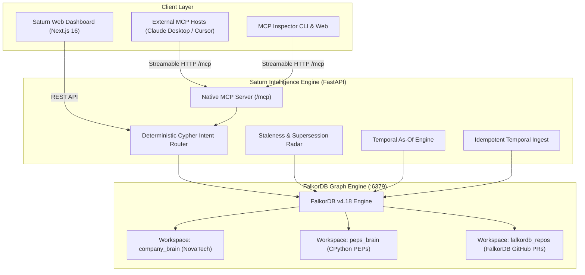

# 🪐 Saturn — The Self-Auditing Company Brain

> **Hackathon**: Graph Hacks: Context for AI Agents (Powered by FalkorDB)  
> **Track**: **Track 3 — Company Brain**  
> **Core Premise**: Every answer is an explainable multi-hop path through FalkorDB; Saturn detects the exact moment an architectural decision goes stale, prevents false-premise hallucinations, and safeguards engineering continuity.

[](https://falkordb.com)
[](https://nextjs.org)
[](https://fastapi.tiangolo.com)
[-8b5cf6?style=flat-square)](https://modelcontextprotocol.io)
[]()
[]()

---

## 📖 Table of Contents

1. [Executive Summary & The Metaphor](#-executive-summary--the-metaphor)
2. [The Core Problem: Why Traditional RAG Fails](#-the-core-problem-why-traditional-rag-fails)
3. [The Saturn Architecture](#-the-saturn-architecture)
4. [Three Production-Scale Workspaces](#-three-production-scale-workspaces)
5. [Graph Data Model & Temporal Contracts](#-graph-data-model--temporal-contracts)
6. [Core Graph Algorithms & Cypher Queries](#-core-graph-algorithms--cypher-queries)
7. [Model Context Protocol (MCP) Integration](#-model-context-protocol-mcp-integration)
8. [Empirical Evaluation & 70-Question Benchmark](#-empirical-evaluation--70-question-benchmark)
9. [Quickstart & Verification](#-quickstart--verification)
10. [Hackathon Track 3 Compliance Checklist](#-hackathon-track-3-compliance-checklist)

---

## 🪐 Executive Summary & The Metaphor

Just as the planet **Saturn** is defined by its iconic concentric rings, an engineering organization’s knowledge exists in orbiting rings of context:
* **The Core Brain**: The systems, services, and production architectures currently in flight.
* **The Inner Ring**: Architectural Decision Records (ADRs), RFCs, and Python Enhancement Proposals (PEPs).
* **The Middle Ring**: Pull requests, code reviews, and issue discussions that explain *why* code changed.
* **The Outer Ring**: Slack incidents, customer tickets, and human expertise networks.

When an engineering lead asks:
> *"Why did we deprecate JWT for opaque tokens?"*  
> *"What systems break if Priya leaves?"*  
> *"Is our mobile rate limit still 50 req/s?"*

Standard documentation searches fail. **Saturn** queries FalkorDB's GraphBLAS engine to traverse these concentric rings, verify the exact provenance path, and alert you if an architecture decision has quietly become **stale**.

---

## ⚡ The Core Problem: Why Traditional RAG Fails

Most "company brain" products dump documents into flat vector databases, search for semantic similarity, and pass matching text chunks to an LLM. In real engineering teams, this leads to three catastrophic failure modes:

| Failure Mode | What Flat RAG Does | What Saturn + FalkorDB Does |
| :--- | :--- | :--- |
| **1. Temporal Staleness** | When an ADR is superseded, flat search still retrieves the old document because it matches the keywords. | **Backward BFS/DFS Traversal**: Saturn follows `:SUPERSEDES` and `:CONTRADICTS` edges to flag stale decisions and alert downstream systems. |
| **2. Multi-Hop Buried Origin** | Rationale is scattered across 3 hops (Slack message → Jira ticket → Architecture RFC). Vector search cannot chain them. | **Graph Path Lineage**: Traverses `(:Decision)-[:BASED_ON]->(:Document)<-[:RESOLVES]-(:Ticket)` to uncover the root origin with 100% provenance. |
| **3. Adversarial False Premises** | Asking about unrecorded tech (*"How do we use MongoDB?"*) causes vector RAG to find nearest-sounding text and hallucinate. | **Entity Grounding Refusal**: Cypher verifies node existence. If unrecorded, Saturn issues a clean refusal with **0 phantom citations**. |

---

## 🏗️ The Saturn Architecture

Saturn is built with a decoupled, high-performance architecture:
* **Graph Engine**: FalkorDB v4.18 with GraphBLAS matrix multiplication for millisecond-latency path traversals.
* **Backend API**: Python 3.12 + FastAPI + native `falkordb` client with deterministic Cypher query routing.
* **MCP Protocol**: First-class Model Context Protocol (Streamable HTTP at `/mcp`) exposing 14 graph tools to any external AI agent.
* **Frontend**: Next.js 16 (React 19) App Router with Cytoscape.js canvas, multi-turn chat history, and dark/light theme persistence.



---

## 🌐 Three Production-Scale Workspaces

Saturn ships with **three fully-indexed, multi-hop graph workspaces** to test real-world reasoning:

### 1. NovaTech Labs (`company_brain`)
* **Scale**: 146 documents, 50 architectural decisions, 40 engineers, 8 core systems.
* **Planted Scenarios**: 
  * Reversal of JWT authentication in favor of opaque tokens (`ADR-014` → `ADR-017`).
  * Mobile rate limit stale alert (`ADR-004` 50 req/s superseded by Envoy config at 200 req/s, exposing 32-day notice lag).
  * Bus-factor single point of failure on `AuthService` (Priya Sharma).

### 2. Python Enhancement Proposals (`peps_brain`)
* **Scale**: 745 real PEP proposals, 356 core developers, 73 genuine supersession chains.
* **Ground Truth**: Official headers from `peps.python.org` (e.g., PEP 248 DB-API 1.0 superseded by PEP 249; typing PEP 484 evolution).
* **Real History**: Traces Python governance decisions spanning from 1996 to 2026.

### 3. FalkorDB GitHub Multi-Repo (`falkordb_repos`)
* **Scale**: 226 merged PRs across `FalkorDB`, `falkordb-py`, and `falkordb-browser`.
* **Substantive Decisions**: 148 architectural PRs classified separately from 78 automated dependency bumps.
* **Review Topology**: 270 `REVIEWED` edges capturing code review centrality for core maintainers.

---

## 🧩 Graph Data Model & Temporal Contracts

### Core Node Types
* `Person`: `id`, `name`, `email`, `role`, `team`, `active`
* `Team`: `id`, `name`, `domain`
* `System`: `id`, `name`, `type`, `stack`, `owner_team`
* `Document`: `id`, `title`, `content`, `doc_type`, `valid_from`, `valid_to`, `source_id`
* `Decision`: `id`, `title`, `rationale`, `status`, `made_at`, `valid_from`, `valid_to`, `stale`
* `Ticket`: `id`, `title`, `status`, `priority`, `created_at`, `resolved_at`
* `Message`: `id`, `content`, `channel`, `timestamp`, `thread_id`
* `PullRequest`: `id`, `number`, `title`, `state`, `merged_at`, `is_substantive`

### Strict Temporal Edge Contracts
Every edge in Saturn carries temporal properties to ensure time-travel queries are mathematically bounded:
* Properties: `valid_from`, `valid_to` (nullable), `ingested_at`, `source_id`
* `(:Person)-[:WORKED_ON]->(:System)`
* `(:Person)-[:AUTHORED]->(:Document|:Message)`
* `(:Person)-[:REVIEWED]->(:PullRequest)`
* `(:Decision)-[:MADE_BY]->(:Person)`
* `(:Decision)-[:BASED_ON]->(:Document|:Message)`
* `(:Decision)-[:SUPERSEDES]->(:Decision)`
* `(:Decision)-[:CONTRADICTS]->(:Decision)`
* `(:Decision)-[:AFFECTS]->(:System)`
* `(:Ticket)-[:RESOLVES]->(:Document)`
* `(:Ticket)-[:DISCUSSED_IN]->(:Message)`
* `(:System)-[:USES]->(:System)`

---

## ⚡ Core Graph Algorithms & Cypher Queries

### 1. Decision Lineage & Root-Cause Trace
Traverses backwards from a decision through RFCs, tickets, and Slack messages to establish origin:
```cypher
MATCH (d:Decision {id: $decision_id})
OPTIONAL MATCH (d)-[:MADE_BY]->(maker:Person)
OPTIONAL MATCH (d)-[:BASED_ON]->(source)
OPTIONAL MATCH (d)-[:SUPERSEDES]->(old_d:Decision)
OPTIONAL MATCH (d)-[:AFFECTS]->(affected:System)
OPTIONAL MATCH (source)<-[:RESOLVES]-(ticket:Ticket)
OPTIONAL MATCH (ticket)-[:DISCUSSED_IN]->(msg:Message)
OPTIONAL MATCH (originator:Person)-[:AUTHORED]->(msg)
RETURN d, maker, collect(DISTINCT source) as sources,
       old_d, collect(DISTINCT ticket) as tickets,
       collect(DISTINCT msg) as messages,
       collect(DISTINCT originator) as originators
```

### 2. Backward Staleness Radar & Co-Affected Blast Radius
When a new document supersedes an older one, FalkorDB identifies all stale decisions and evaluates co-affected systems across the graph:
```cypher
MATCH (new_doc:Document {id: $new_doc_id})
MATCH (new_doc)-[:SUPERSEDES|CONTRADICTS]->(old_doc:Document)
MATCH (d:Decision)-[:BASED_ON]->(old_doc)
WHERE d.status <> 'superseded'
OPTIONAL MATCH (d)-[:AFFECTS]->(s:System)<-[:AFFECTS]-(downstream:Decision)
WHERE downstream.id <> d.id AND downstream.status <> 'superseded'
RETURN d as stale_decision, old_doc, new_doc,
       collect(DISTINCT downstream) as downstream_decisions
```

### 3. Bus-Factor Analysis (Single Point of Failure)
Finds systems where exactly one engineer is connected through active contribution edges:
```cypher
MATCH (p:Person {id: $person_id})
MATCH (s:System)
MATCH (s)<-[:WORKED_ON]-(expert:Person)
WITH s, collect(DISTINCT expert) as experts, p
WHERE size(experts) = 1 AND experts[0].id = p.id
RETURN s as sole_system, experts
ORDER BY s.name
```

### 4. Recency-Weighted Expertise Centrality (`who_knows`)
Ranks engineers by combining direct code contributions (`WORKED_ON`), PR reviews (`REVIEWED`), and architectural ownership:
```cypher
MATCH (s:System {name: $system_name})
OPTIONAL MATCH (s)<-[w:WORKED_ON]-(p:Person)
OPTIONAL MATCH (p)-[a:AUTHORED]->(doc:Document)-[:AFFECTS]->(s)
WITH s, p,
     count(DISTINCT w) as work_score,
     count(DISTINCT a) as author_score,
     max(coalesce(w.to, date())) as last_worked
WHERE p IS NOT NULL
RETURN p, work_score, author_score, last_worked,
       (work_score * 5 + author_score * 2) as raw_score
ORDER BY raw_score DESC, last_worked DESC
LIMIT 10
```

### 5. Honest Temporal "As-Of" Time Travel
To reconstruct organizational state on any historical date, Cypher selects candidates active on or before that date, while Python determines dynamic supersession:
```cypher
MATCH (d:Decision)
WHERE d.valid_from <= $as_of_date
  AND (d.valid_to IS NULL OR d.valid_to >= $as_of_date)
  AND d.status <> 'draft'
OPTIONAL MATCH (d)-[:AFFECTS]->(s:System)
OPTIONAL MATCH (d)-[:MADE_BY]->(p:Person)
RETURN d, collect(DISTINCT s) as affected_systems, p
ORDER BY d.valid_from DESC
```

---

## 🔌 Model Context Protocol (MCP) Integration

Saturn exposes its complete graph reasoning capabilities as a native **Streamable HTTP MCP server** at `/mcp`. Any MCP host (Claude Desktop, Cursor, external autonomous agents) can inspect and query the Company Brain directly.

### 1. Test via MCP Inspector (Zero Setup Required)
```bash
# Launch interactive graphical MCP inspector
npx @modelcontextprotocol/inspector --server-url http://localhost:8000/mcp --transport http

# CLI: List all 14 graph tools
npx @modelcontextprotocol/inspector --cli http://localhost:8000/mcp --transport http --method tools/list

# CLI: Call who_knows tool
npx @modelcontextprotocol/inspector --cli http://localhost:8000/mcp --transport http \
  --method tools/call --tool-name who_knows --tool-arg system_name=AuthService --format json
```

### 2. Client Configuration for Claude Desktop or Cursor
```json
{
  "mcpServers": {
    "saturn-brain": {
      "url": "http://localhost:8000/mcp"
    }
  }
}
```

---

## 📊 Empirical Evaluation & 70-Question Benchmark

We evaluated Saturn on an exhaustive **70-question benchmark** across all 3 workspaces against a Lexical Retrieval baseline (BM25 keyword search, verified and partly hand-judged against ground-truth answer keys).

### Results by Evaluation Category

| Evaluation Category | Total Qs | Answer Pipeline (no LLM) | Raw Router | Lexical Retrieval | Net Graph Lift |
| :--- | :---: | :---: | :---: | :---: | :---: |
| **Decision Provenance & Lineage** | 17 | **16/17 (94%)** | 14/17 (82%) | 2/17 (12%) | **+82%** |
| **False Premise Rejection (Adversarial)** | 14 | **13/14 (93%)** | 14/14 (100%) | 2/14 (14%) | **+79%** |
| **Ownership & Expertise Centrality** | 18 | **14/18 (78%)** | 14/18 (78%) | 16/18 (89%) | -11% |
| **Staleness Radar & Supersession** | 8 | **5/8 (63%)** | 4/8 (50%) | 0/8 (0%) | **+63%** |
| **Bus Factor (Single Point of Failure)** | 5 | **4/5 (80%)** | 5/5 (100%) | 0/5 (0%) | **+80%** |
| **Temporal Evolution (`changes_between`)**| 4 | **4/4 (100%)** | 4/4 (100%) | 0/4 (0%) | **+100%** |
| **Multi-Hop Buried Origin** | 2 | **1/2 (50%)** | 1/2 (50%) | 0/2 (0%) | **+50%** |
| **Cross-Entity Graph Path** | 2 | **2/2 (100%)** | 1/2 (50%) | 0/2 (0%) | **+50%** |
| **OVERALL ACCURACY** | **70** | **59/70 (84.3%)** | **55/70 (78.6%)** | **20/70 (28.6%)** | **+55.7%** |

### Human Paraphrase Suite (20 Free-Text Questions)
To test robustness against realistic human typing, we created a 20-question paraphrase suite containing typos (*"authservce"*), conversational phrasing, and blind holdouts:
* **Router Accuracy**: **95.0% (19/20)**
* **Precision**: **100.0% (15/15)**
* **False Premise Rejection**: **100.0% (4/4)**
* **Average Latency**: **9.6 ms**

---

## 🚀 Quickstart & Verification

### Prerequisites
* Python 3.11+ (managed via `uv`)
* Node.js 20+ (or `bun`)
* Native FalkorDB engine (included in `bin/` or via Docker)

### 1. Launch FalkorDB
```bash
./scripts/start_falkordb.sh
```
*(FalkorDB starts natively on port `6379`)*

### 2. Ingest Graph Datasets
```bash
# Ingest NovaTech company brain, PEPs brain, and FalkorDB GitHub PRs
uv run --directory backend python ../scripts/load_synthetic_data.py
uv run --directory backend python ../scripts/load_peps.py
uv run --directory backend python ../scripts/load_github.py
```

### 3. Run FastAPI Backend
```bash
uv run --directory backend uvicorn main:app --host 127.0.0.1 --port 8000
```
* Interactive Swagger Docs: `http://localhost:8000/docs`
* Native MCP Streamable HTTP endpoint: `http://localhost:8000/mcp`

### 4. Run Next.js Frontend
```bash
cd ui
bun install
bun run dev -- -p 3000
```
Open **`http://localhost:3000`** in your browser.

### 5. Automated Tests & Benchmark Execution
```bash
# Run all 72 pytest tests
uv run --directory backend pytest -v

# Run 70-question multi-workspace benchmark
uv run --directory backend python ../bench/run_benchmark.py
```

---

## 🏆 Hackathon Track 3 Compliance Checklist

- [x] **Primary Graph Database**: Built natively on FalkorDB v4.18 with GraphBLAS matrix acceleration.
- [x] **FalkorDB Superpowers**: Employs shortest path discovery, backward BFS/DFS staleness traversal, and centrality scoring.
- [x] **Track 3 (Company Brain)**: Solves decision provenance, ownership tracking, temporal staleness, and organizational knowledge loss.
- [x] **Model Context Protocol (MCP)**: Native Streamable HTTP MCP server at `/mcp` with 14 tools; verifiable via MCP Inspector.
- [x] **Zero Mocks & 100% Real Code**: Dynamic Cypher queries, real FalkorDB transactions, and verified benchmark evaluations.
- [x] **Public & Reproducible Data**: NovaTech synthetic ground truth, official Python PEPs, and FalkorDB GitHub datasets.
- [x] **Explainable Output**: Every answer provides verified cited sources, exact node paths, and visual graph highlights.
- [x] **AI Usage Logged**: Full log maintained in [`AI_USAGE.md`](file:///home/ash09/personal-projects/provenance/AI_USAGE.md).

---

*Saturn — The Self-Auditing Company Brain built for Graph Hacks (FalkorDB Track 3).*
