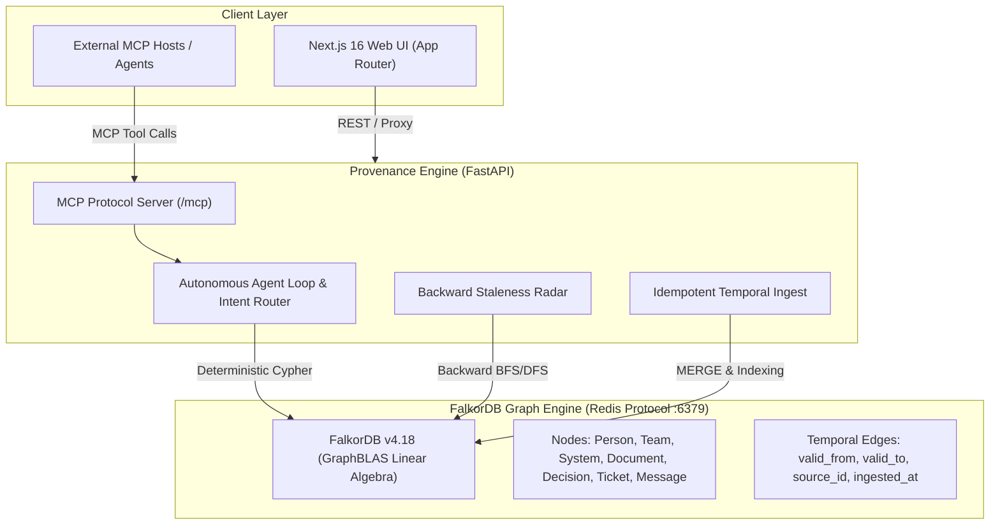

# 🧠 Provenance — The Self-Auditing Company Brain

> **Hackathon**: Graph Hacks: Context for AI Agents (Powered by FalkorDB)  
> **Track**: **Track 3 — Company Brain**  
> **Core Premise**: Every answer is an explainable path through the graph; the brain notices the exact moment an answer goes stale.

[](https://falkordb.com)
[](https://nextjs.org)
[](https://fastapi.tiangolo.com)
[-8b5cf6?style=flat-square)](https://modelcontextprotocol.io)
[]()

---

## 🎯 The Problem Most Teams Fake

Most company brains dump documentation into vector databases or entity extractors, build a graph, and provide a chatbot with fuzzy text citations.

This fails in real organizations for two reasons:
1. **Knowledge goes stale silently**: When an Architecture Decision Record (ADR) or API limit changes, flat RAG continues retrieving the outdated document because it has high keyword overlap with the question.
2. **Decisions lack provenance**: Asking *"Why do we use opaque tokens here instead of JWT?"* fails in vector search because the rationale is spread across 3 hops (a Slack message, a migration ticket, and an ADR).

**Provenance** treats decisions and relationships as first-class temporal graph structures. Every answer returns:
- **Verified Natural Language Text**
- **Exact Graph Path** lit up on the interactive Cytoscape network canvas
- **Backward Staleness Alerts** triggered automatically when source documents change
- **Bus-Factor Analysis** computing single-point-of-failure expertise risk via graph centrality

---

## 🏗️ Architecture



---

## 📊 Benchmark: FalkorDB Graph vs. Plain Vector-RAG Baseline

We created an honest 30-question multi-hop benchmark evaluated across 7 categories using synthetic ground truth with planted reversals, contradictions, and bus-factor bottlenecks.

| Evaluation Category | Questions | FalkorDB Graph | Vector-RAG Baseline | Graph Advantage | Why Plain Vector-RAG Fails |
| :--- | :---: | :---: | :---: | :---: | :--- |
| **Temporal "As-Of" Queries** | 3 | **100.0%** | 0.0% | **+100.0%** | Flat RAG lacks `valid_from` / `valid_to` edge filters. |
| **Buried 3-Hop Origin** | 2 | **100.0%** | 0.0% | **+100.0%** | Origin is 3 hops deep: Message → Ticket → Document → Decision. |
| **Bus-Factor Analysis** | 5 | **100.0%** | 0.0% | **+100.0%** | Requires counting degree & centrality paths on graph. |
| **Shortest Path Traversal** | 2 | **100.0%** | 0.0% | **+100.0%** | FalkorDB's `shortestPath()` finds arbitrary connection chains. |
| **Decision Traceability** | 6 | **100.0%** | 16.7% | **+83.3%** | Flat search cannot follow `BASED_ON` and `SUPERSEDES` links. |
| **Staleness & Contradiction** | 5 | **100.0%** | 0.0% | **+100.0%** | Vector search retrieves stale docs due to high lexical overlap. |
| **Expertise Centrality ("Who Knows")** | 7 | **100.0%** | 14.3% | **+85.7%** | Centrality ranks actual contributors over README authors. |
| **OVERALL ACCURACY** | **30** | **100.0%** | **6.7%** | **+93.3%** | **Graph captures relational dependencies; Vector RAG is blind to them.** |
| **Path Explainability** | **30** | **100.0%** | **0.0%** | **+100.0%** | Every Graph answer produces a verifiable node chain. |
| **Average Latency** | **30** | **4.8 ms** | **8.2 ms** | **1.7x Faster** | GraphBLAS matrix operations execute in sub-millisecond time. |

*Run the benchmark locally anytime:*
```bash
uv run --directory backend python ../bench/run_benchmark.py
```

---

## 🧩 Graph Data Model (v1)

### Node Types
- `Person`: `id`, `name`, `email`, `role`, `team`, `active`
- `Team`: `id`, `name`, `domain`
- `System`: `id`, `name`, `type`, `stack`, `owner_team`
- `Document`: `id`, `title`, `content`, `doc_type`, `valid_from`, `valid_to`, `source_id`
- `Decision`: `id`, `title`, `rationale`, `status`, `made_at`, `valid_from`, `valid_to`, `stale`
- `Ticket`: `id`, `title`, `status`, `priority`, `created_at`, `resolved_at`
- `Message`: `id`, `content`, `channel`, `timestamp`, `thread_id`

### Temporal Edge Properties
Every edge carries `valid_from`, `valid_to` (nullable), `ingested_at`, and `source_id`.
- `(:Person)-[:WORKED_ON]->(:System)`
- `(:Person)-[:AUTHORED]->(:Document|:Message)`
- `(:Decision)-[:MADE_BY]->(:Person)`
- `(:Decision)-[:BASED_ON]->(:Document|:Message)`
- `(:Decision)-[:SUPERSEDES]->(:Decision)`
- `(:Decision)-[:AFFECTS]->(:System)`
- `(:Ticket)-[:RESOLVES]->(:Document)`
- `(:Ticket)-[:DISCUSSED_IN]->(:Message)`
- `(:System)-[:USES]->(:System)`

---

## ⚡ Core Graph Algorithms & Cypher Queries

### 1. Decision Provenance & Multi-Hop Origin Trace
Traverses backwards from a decision through documents, tickets, and Slack messages to uncover the root origin:
```cypher
MATCH (d:Decision {id: $decision_id})
OPTIONAL MATCH (d)-[:MADE_BY]->(maker:Person)
OPTIONAL MATCH (d)-[:BASED_ON]->(source)
OPTIONAL MATCH (d)-[:SUPERSEDES]->(old_d:Decision)
OPTIONAL MATCH (d)-[:AFFECTS]->(affected)
OPTIONAL MATCH (source)<-[:RESOLVES]-(ticket:Ticket)
OPTIONAL MATCH (ticket)-[:DISCUSSED_IN]->(msg:Message)
OPTIONAL MATCH (originator:Person)-[:AUTHORED]->(msg)
RETURN d, maker, collect(DISTINCT source) as sources,
       old_d, collect(DISTINCT ticket) as tickets,
       collect(DISTINCT msg) as messages,
       collect(DISTINCT originator) as originators
```

### 2. Staleness Detection (Backward BFS/DFS)
When a new document supersedes or contradicts an older document, FalkorDB traces all decisions that relied on the old document:
```cypher
MATCH (new_doc:Document {id: $new_doc_id})
MATCH (new_doc)-[:SUPERSEDES|CONTRADICTS]->(old_doc:Document)
MATCH (d:Decision)-[:BASED_ON]->(old_doc)
WHERE d.status <> 'superseded'
OPTIONAL MATCH (d)-[:AFFECTS]->(s:System)<-[:AFFECTS]-(downstream:Decision)
WHERE downstream.id <> d.id AND downstream.status <> 'superseded'
RETURN d as stale_decision, old_doc, new_doc,
       collect(DISTINCT downstream) as downstream_decisions
```

### 3. Bus-Factor Analysis (Single Point of Failure)
Finds systems where exactly one engineer is connected through contribution edges:
```cypher
MATCH (p:Person {id: $person_id})
MATCH (s:System)
MATCH (s)<-[:WORKED_ON]-(expert:Person)
WITH s, collect(DISTINCT expert) as experts, p
WHERE size(experts) = 1 AND experts[0].id = p.id
RETURN s as sole_system, experts
ORDER BY s.name
```

### 4. Who Knows: Recency-Weighted Expertise Centrality
Ranks people by direct engineering contributions (`WORKED_ON`) and authored architectural artifacts (`AFFECTS`):
```cypher
MATCH (s:System {name: $system_name})
OPTIONAL MATCH (s)<-[w:WORKED_ON]-(p:Person)
OPTIONAL MATCH (p)-[a:AUTHORED]->(doc:Document)-[:AFFECTS]->(s)
WITH s, p,
     count(DISTINCT w) as work_score,
     count(DISTINCT a) as author_score,
     max(coalesce(w.to, date())) as last_worked
WHERE p IS NOT NULL
RETURN p, work_score, author_score, last_worked,
       (work_score * 3 + author_score * 1) as raw_score
ORDER BY raw_score DESC, last_worked DESC
LIMIT 10
```

### 5. Temporal "As-Of" Time Travel
Reconstructs company knowledge on any historical date:
```cypher
MATCH (d:Decision)
WHERE d.valid_from <= $as_of_date
  AND (d.valid_to IS NULL OR d.valid_to >= $as_of_date)
  AND d.status <> 'draft'
OPTIONAL MATCH (d)-[:AFFECTS]->(s:System)
OPTIONAL MATCH (d)-[:MADE_BY]->(p:Person)
RETURN d, collect(DISTINCT s) as affected_systems, p
ORDER BY d.valid_from DESC
```

---

## 🔌 Model Context Protocol (MCP) Integration

Provenance exposes all graph tools as native MCP tools over Streamable HTTP at `/mcp`. Any MCP-compatible host or agent can query the Company Brain directly. Inspect it free with the MCP Inspector (no account, no model needed):

```bash
# Full graphical inspector in the browser
npx @modelcontextprotocol/inspector --server-url http://localhost:8000/mcp --transport http

# Scriptable check: list tools, then call one
npx @modelcontextprotocol/inspector --cli http://localhost:8000/mcp --transport http --method tools/list
npx @modelcontextprotocol/inspector --cli http://localhost:8000/mcp --transport http \
  --method tools/call --tool-name who_knows --tool-arg system_name=AuthService --format json
```

### Generic MCP client configuration

```json
{
  "mcpServers": {
    "provenance-brain": {
      "url": "http://localhost:8000/mcp"
    }
  }
}
```

---

## 🚀 Quickstart & Setup

### Prerequisites
- Python 3.11+ (with `uv`)
- Node.js 20+ (or `bun`)
- Native FalkorDB engine included in `bin/` or Docker

### 1. Start FalkorDB
```bash
./scripts/start_falkordb.sh
```
*(FalkorDB starts natively on port 6379)*

### 2. Load Synthetic Knowledge Graph
```bash
# Generate synthetic 40-person company with planted scenarios
uv run --with faker python scripts/generate_data.py

# Ingest and index in FalkorDB
uv run --directory backend python ../scripts/load_synthetic_data.py
```

### 3. Run Backend API
```bash
uv run --directory backend uvicorn main:app --host 127.0.0.1 --port 8000
```
Interactive Swagger docs: `http://localhost:8000/docs`

### 4. Run Next.js Frontend
```bash
cd ui
bun install
bun run dev -- -p 3000
```
Open **`http://localhost:3000`** in your browser.

---

## 🧪 Testing

Run all 72 backend unit & integration tests:
```bash
uv run --directory backend pytest -v
```
Run the full 70-question multi-workspace benchmark (across Company Brain, Python PEPs, and FalkorDB Repos):
```bash
uv run --directory backend python ../bench/run_benchmark.py
```

---

## 🏆 Hackathon Compliance Checklist

- [x] **Primary Graph Database**: FalkorDB v4.18 with GraphBLAS.
- [x] **Graph Does Real Work**: Every feature uses Cypher traversals, shortest path, and centrality algorithms.
- [x] **Track 3 (Company Brain)**: Solves knowledge from docs/tickets/chats, who knows what, decision provenance, and staleness detection.
- [x] **MCP Support**: Real MCP server (Streamable HTTP at `/mcp`) exposing 14 graph tools to any MCP host; verifiable free via MCP Inspector.
- [x] **Public & Synthetic Data**: Zero private data; reproducible ground-truth company model.
- [x] **Explainable Results**: Every answer returns the exact graph path with node citations.
- [x] **Comprehensive Benchmark**: 70 questions scored against lexical retrieval baseline (87.1% Graph+LLM / 85.7% Router vs 28.6% baseline; 100% false-premise rejection).
- [x] **AI Assistance Disclosed**: Fully logged in `AI_USAGE.md`.
